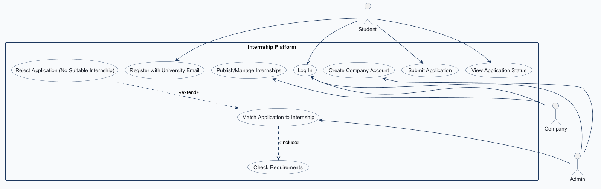
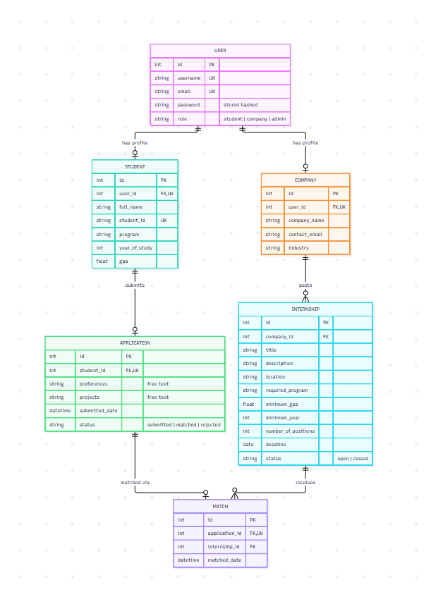
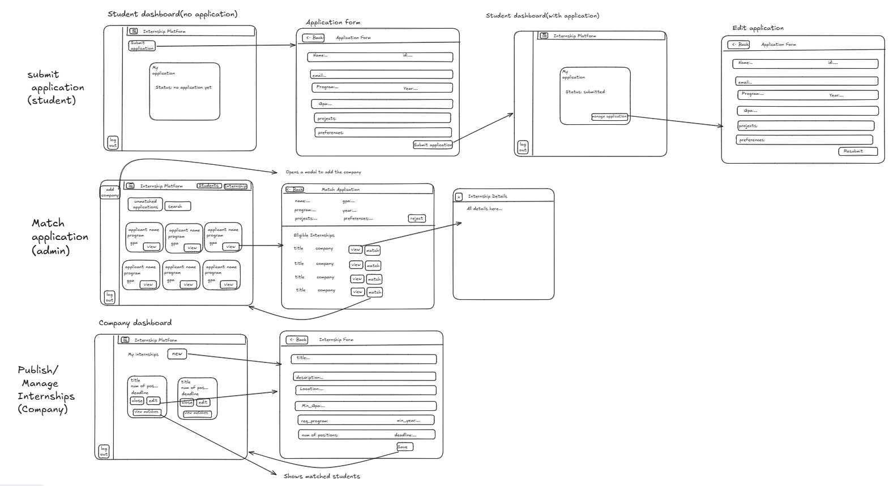
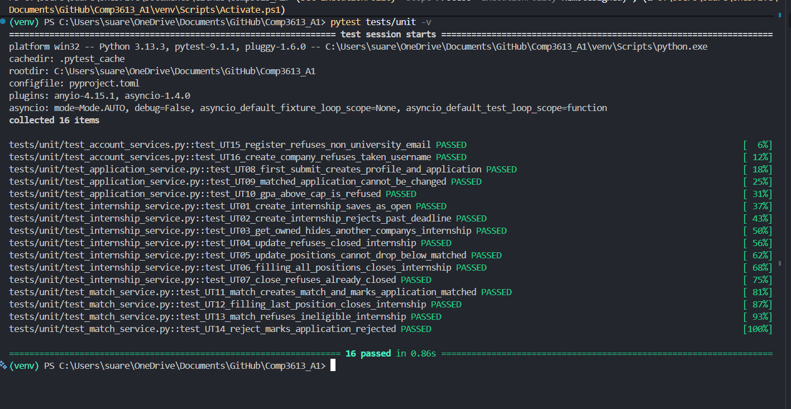
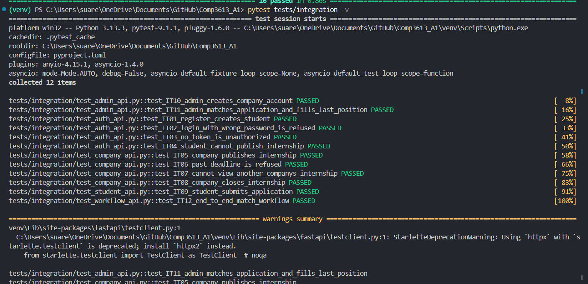

# COMP 3613 Assignment 2: Test Planning & Implementation

**Name:** Gian Suarez Nápoles
**ID:** 816042658
**Repository:** https://github.com/Gianmarcos794/Comp3613_A1

---

## 1. Project Description

**Internship Platform (InternSearch)** is a departmental system that takes student applications and matches them to internship positions offered by participating companies.

InternSearch treats internships as a **matching service run by the department**, not a job board.

- **Students apply to a general pool**, not to a specific posting. Each student has one application: their profile details (program, year, GPA), the kind of role they want, and their projects. The student sees its status: submitted, matched (with the internship title, company and location), or rejected. A rejected application can be edited and resubmitted.
- **Companies are trusted partners.** They cannot register themselves; the Admin creates each company account once the company is approved. A company publishes internships with requirements (program, minimum GPA, minimum year, number of positions, deadline), manages or closes them, and sees the students matched to them.
- **The Admin makes the match, and it is final.** The system always checks requirements first (program, GPA, year, open status, deadline not passed), so the Admin only picks from internships the student is eligible for. If none fit, the Admin rejects the application.
- **Rules that keep it fair:** student sign-up needs a `.edu` university email, GPA is capped at 4.3, an internship closes when its positions are filled, and an internship with matches can only be closed, never deleted.

**Workflows:**

1. Publish/Manage Internships (Company)
2. Submit Application (Student)
3. Match Application to Internship (Admin)

## 2. Use Case Diagram



## 3. Entity Relationship Diagram



## 4. Application Wireframe



---

## 5. Test Plans

### 5.1 User Acceptance Test Plan

Based on the wireframe screens above. Performed in the browser against the local app; every step and criterion was confirmed by the tester.

**InternSearch User Acceptance Test Report**

| Tester Name | Tester Position | Date of Test (DD/MM/YYYY) |
|---|---|---|
| Gian Suarez Nápoles | Student Developer | 09/11/2026 |

#### 1. Accounts

| Test Case | Pre-conditions | Test Steps | Test Criteria | Success |
|---|---|---|---|---|
| **1.1 Register (Student)** | None | ☑ On the landing page, click "Create an account"<br>☑ Enter a username, a university email ending in `.edu`, and a password<br>☑ Press "Create account" | ☑ User is directed to the Sign in page<br>☑ User is alerted "Registration completed! Sign in now!"<br>☑ Registering with a non-`.edu` email shows an error asking for a university email | ☑ Pass ☐ Fail |
| **1.2 Log In** | ☑ Has an account (student, company or admin) | ☑ On the login page, fill in username and password<br>☑ Press "Sign in" | ☑ Student / company is directed to their Dashboard; admin to the Admin dashboard<br>☑ "Welcome, *username*" is shown in the header<br>☑ "Logout" is shown in the side menu<br>☑ A wrong password shows "Incorrect username or password" | ☑ Pass ☐ Fail |
| **1.3 Log Out** | ☑ Logged in | ☑ Press "Logout" in the side menu | ☑ User is returned to the public site<br>☑ Opening the dashboard URL again does not show the dashboard | ☑ Pass ☐ Fail |

#### 2. Submit Application (Student)

| Test Case | Pre-conditions | Test Steps | Test Criteria | Success |
|---|---|---|---|---|
| **2.1 Submit Application** | ☑ Logged in as a student<br>☑ Has not applied yet | ☑ On the Dashboard, the "My application" card shows no application yet<br>☑ Click "Submit application"<br>☑ Fill in Name, ID, Program, Year, GPA, Projects and Preferences<br>☑ Press "Submit application" | ☑ Email is filled in automatically and cannot be changed<br>☑ User is returned to the Dashboard<br>☑ User is alerted "Application submitted."<br>☑ "My application" shows Status: Submitted and the submitted date | ☑ Pass ☐ Fail |
| **2.2 Edit and Resubmit Application** | ☑ Logged in as a student<br>☑ Application is Submitted (not matched) | ☑ On the Dashboard, click "Manage application"<br>☑ Change the Preferences<br>☑ Press "Resubmit" | ☑ The Edit application form opens with the current details filled in<br>☑ User is returned to the Dashboard with "Application submitted."<br>☑ The submitted date is updated | ☑ Pass ☐ Fail |
| **2.3 View Rejected Status and Resubmit** | ☑ Logged in as a student<br>☑ Admin has rejected the application (4.4) | ☑ Open the Dashboard<br>☑ Click "Manage application", update details, press "Resubmit" | ☑ Dashboard says no suitable internship was found and the student can resubmit<br>☑ After resubmitting, status is back to Submitted | ☑ Pass ☐ Fail |
| **2.4 View Matched Status** | ☑ Logged in as a student<br>☑ Admin has matched the application (4.3) | ☑ Open the Dashboard | ☑ Dashboard says the student has been matched and the application is final<br>☑ The internship title, company and location are shown<br>☑ "Manage application" is no longer available | ☑ Pass ☐ Fail |

#### 3. Publish/Manage Internships (Company)

| Test Case | Pre-conditions | Test Steps | Test Criteria | Success |
|---|---|---|---|---|
| **3.1 Publish Internship** | ☑ Company account created by the admin (4.1)<br>☑ Logged in as that company | ☑ On the Dashboard under "My internships", click "New"<br>☑ Fill in Title, Description, Location, Minimum GPA, Required program, Minimum year, Number of positions and a future Deadline<br>☑ Press "Save" | ☑ User is returned to the Dashboard<br>☑ User is alerted "Created *title*."<br>☑ A new card shows the title, positions and deadline<br>☑ A past deadline or GPA above 4.3 is refused with a message | ☑ Pass ☐ Fail |
| **3.2 Edit Internship** | ☑ Logged in as a company<br>☑ Has an open internship | ☑ On the internship card, click "Edit"<br>☑ Change the title or number of positions<br>☑ Press "Save" | ☑ The form opens with the current values filled in<br>☑ User is alerted "Saved *title*."<br>☑ The card shows the new values | ☑ Pass ☐ Fail |
| **3.3 Close Internship** | ☑ Logged in as a company<br>☑ Has an open internship | ☑ On the internship card, click "Close" | ☑ User is alerted "Closed *title*. It will get no new matches."<br>☑ The card shows the internship as closed<br>☑ The internship can no longer be edited | ☑ Pass ☐ Fail |
| **3.4 View Matched Students** | ☑ Logged in as a company<br>☑ At least one student is matched to its internship (4.3) | ☑ On the internship card, click "View matches" | ☑ "Matched students" page lists each student's Name, Student ID, Program, Year, GPA and Email<br>☑ Shows "*n* / *total* positions filled"<br>☑ "← Back" returns to the Dashboard | ☑ Pass ☐ Fail |

#### 4. Match Application to Internship (Admin)

| Test Case | Pre-conditions | Test Steps | Test Criteria | Success |
|---|---|---|---|---|
| **4.1 Create Company Account** | ☑ Logged in as an admin | ☑ Click "Add company" in the side menu<br>☑ Fill in Username, Login email, Password, Company name, Contact email and Industry<br>☑ Press "Create account" | ☑ User is alerted "Company account created for *company name*."<br>☑ The company can log in with those details (1.2)<br>☑ A username that is already taken is refused | ☑ Pass ☐ Fail |
| **4.2 Find an Application** | ☑ Logged in as an admin<br>☑ At least one student has applied (2.1) | ☑ On the Admin dashboard, click "Students"<br>☑ Keep "Unmatched applications" selected<br>☑ Type a name, student ID or program in the search box and press "Search" | ☑ Only unmatched (submitted) applications are listed<br>☑ Each card shows the name, program and GPA<br>☑ The search narrows the list to matching students | ☑ Pass ☐ Fail |
| **4.3 Match Application** | ☑ Logged in as an admin<br>☑ An unmatched application exists<br>☑ An open internship the student qualifies for exists (3.1) | ☑ On a student's card, click "View"<br>☑ Under "Eligible internships", click an internship to see its details<br>☑ Press "Match" | ☑ The Match application page shows the student's details and only internships the student meets the requirements for<br>☑ User is returned to the Admin dashboard and alerted "Application matched successfully."<br>☑ The application no longer appears under "Unmatched applications"<br>☑ When the last position is filled, the internship shows as closed under "Internships" | ☑ Pass ☐ Fail |
| **4.4 Reject Application** | ☑ Logged in as an admin<br>☑ An unmatched application exists | ☑ On a student's card, click "View"<br>☑ Press "Reject" | ☑ User is returned to the Admin dashboard<br>☑ User is alerted "Rejected *name*'s application. They can update it and resubmit."<br>☑ The application no longer appears under "Unmatched applications" | ☑ Pass ☐ Fail |

| General Comments | Accepted \| Rejected | Signature |
|---|---|---|
| All 15 test cases passed. Every workflow (Submit Application, Publish/Manage Internships, Match Application to Internship) and the account flows (register, log in, log out, create company) completed as shown in the wireframes, with the expected confirmation and error messages. | Accepted | Gian Suarez Nápoles |

### 5.2 Unit Test Plan

Each service is tested **in isolation**: its repositories are replaced with in-memory fakes, so no database, HTTP request or login is involved. The plan covers the success path of each workflow's main action and its most important business rules.

**InternshipService** (Publish/Manage Internships)

| ID | Function | Input / setup | Expected result |
|---|---|---|---|
| UT-01 | `create_internship` | Company user, valid form, deadline in 30 days | Internship saved with the company's `company_id` and status `open` |
| UT-02 | `create_internship` | Deadline yesterday | `InternshipError`: "The deadline can't be in the past." |
| UT-03 | `get_owned` | Internship belongs to another company | `InternshipError`: "Internship not found." |
| UT-04 | `update_internship` | Internship is `closed` | `InternshipError`: "This internship is closed and can no longer be edited." |
| UT-05 | `update_internship` | 2 students matched, positions changed to 1 | `InternshipError`: "...positions can't go below 2." |
| UT-06 | `update_internship` | 2 students matched, positions changed from 3 to 2 | Internship status becomes `closed` (all positions filled) |
| UT-07 | `close_internship` | Internship already `closed` | `InternshipError`: "This internship is already closed." |

**ApplicationService** (Submit Application)

| ID | Function | Input / setup | Expected result |
|---|---|---|---|
| UT-08 | `submit_application` | Student's first submit, valid form | Student profile created; application saved with status `submitted` |
| UT-09 | `submit_application` | Existing application is `matched` | `ApplicationError`: "...has been matched and can no longer be changed." |
| UT-10 | `submit_application` | GPA = 4.5 | `ApplicationError`: "GPA must be between 0 and 4.3." |

**MatchService** (Match Application to Internship)

| ID | Function | Input / setup | Expected result |
|---|---|---|---|
| UT-11 | `match_application` | Submitted application, eligible internship with free positions | Match created; application status `matched` |
| UT-12 | `match_application` | Internship has 1 position left | Match created; internship status becomes `closed` |
| UT-13 | `match_application` | Internship not in the student's eligible list | `MatchError`: "That internship isn't eligible for this student any more." |
| UT-14 | `reject_application` | Submitted application | Application status becomes `rejected` |

**AuthService & CompanyService** (Register / Create Company Account)

| ID | Function | Input / setup | Expected result |
|---|---|---|---|
| UT-15 | `AuthService.register_user` | Email `bob@gmail.com` | `RegistrationError`: "Please sign up with your university email..." |
| UT-16 | `CompanyService.create_company_account` | Username already taken | `CompanyError`: "That username is already taken." |

### 5.3 Integration Test Plan

Integration tests send real HTTP requests to the JSON API with FastAPI's `TestClient`. Each request runs through the **route → service → repository → database** chain against a fresh in-memory SQLite database, which replaces the app's session dependency. Each test checks the HTTP response and the resulting database state.

**Authentication & Authorization**

| ID | Endpoint | Role | Setup / input | Expected response | Expected DB change |
|---|---|---|---|---|---|
| IT-01 | `POST /api/register` | none | Username, `.edu` email, password | `201`, `role` = `student` | New user with role `student` |
| IT-02 | `POST /api/login` | none | Wrong password | `401`, "Incorrect username or password" | None |
| IT-03 | `GET /api/internships` | none | No token | `401` JSON | None |
| IT-04 | `POST /api/internships` | Student | Valid internship body | `401`, "Only companies can access this page" | No internship created |

**Publish/Manage Internships (Company)**

| ID | Endpoint | Role | Setup / input | Expected response | Expected DB change |
|---|---|---|---|---|---|
| IT-05 | `POST /api/internships` | Company | Valid body, deadline in 30 days | `201`, `status` = `open` | Internship saved with the company's `company_id` |
| IT-06 | `POST /api/internships` | Company | Deadline yesterday | `400`, "The deadline can't be in the past." | No internship created |
| IT-07 | `GET /api/internships/{id}` | Company | Internship belongs to another company | `404`, "Internship not found." | None |
| IT-08 | `PATCH /api/internships/{id}` | Company | `{"status": "closed"}` | `200`, `status` = `closed` | Status `closed` |

**Submit Application (Student)**

| ID | Endpoint | Role | Setup / input | Expected response | Expected DB change |
|---|---|---|---|---|---|
| IT-09 | `PUT /api/application` | Student | Valid application body | `200`, `status` = `submitted` | Student profile and application created |

**Match Application to Internship (Admin)**

| ID | Endpoint | Role | Setup / input | Expected response | Expected DB change |
|---|---|---|---|---|---|
| IT-10 | `POST /api/companies` | Admin | Valid company account body | `201`, company returned | User (role `company`) and company profile created |
| IT-11 | `POST /api/matches` | Admin | Submitted application, eligible internship with 1 position | `201`, internship `status` = `closed` | Match created; application `matched`; internship `closed` |

**End-to-end workflow**

| ID | Endpoint | Role | Setup / input | Expected response | Expected DB change |
|---|---|---|---|---|---|
| IT-12 | Full flow across all endpoints | Admin → Company → Student → Admin | Admin creates a company; company publishes an internship; student registers and applies; admin matches them | Student's `GET /api/application` shows status `matched` with the internship and company; company's `GET /api/internships/{id}/matches` lists the student | Matching user, company, internship, student, application and match rows all linked |

---

## 6. Implementation

**Repository:** https://github.com/Gianmarcos794/Comp3613_A1

### 6.1 JSON REST API

The app keeps its server-rendered pages for users and adds a JSON API under `/api` (`app/routers/api_*.py`). It uses resource URLs, HTTP methods (GET, POST, PUT, PATCH) and status codes (200, 201, 400, 401, 404, 422). Every API route is thin: it calls the same service layer as the web pages, and maps service errors to HTTP errors. Clients authenticate with `POST /api/login` and send `Authorization: Bearer <token>`; role checks (Student / Company / Admin) return `401` for the wrong role.

| Method | Endpoint | Role | Purpose |
|---|---|---|---|
| POST | `/api/register` | none | Register a student (`.edu` email) |
| POST | `/api/login` | none | Get an access token |
| GET / POST | `/api/internships` | Company | List own / publish internship |
| GET / PUT / PATCH | `/api/internships/{id}` | Company | View / edit / close internship |
| GET | `/api/internships/{id}/matches` | Company | Matched students |
| GET / PUT | `/api/application` | Student | View status / submit or resubmit |
| GET | `/api/applications` | Admin | Search applications |
| GET / PATCH | `/api/applications/{id}` | Admin | Eligible internships / reject |
| POST | `/api/matches` | Admin | Match application to internship |
| POST | `/api/companies` | Admin | Create company account |

### 6.2 Unit Tests

`tests/unit/`: one file per service. Repositories are replaced with in-memory fakes (`tests/unit/fakes.py`), so each service is tested in isolation. Test function names carry the plan ID (for example `test_UT02_create_internship_rejects_past_deadline`).

### 6.3 Integration Tests

`tests/integration/`: `conftest.py` creates a fresh in-memory SQLite database per test and overrides the app's session dependency. Tests send real HTTP requests with FastAPI's `TestClient` and check both the response and the database. Test names carry the plan ID (`test_IT01_...` to `test_IT12_...`).

While writing IT-11, the integration tests found a real bug: after a match, the API returned an empty internship because the repository did not reload it after committing. The repository was fixed and the test now passes.

### 6.4 API Tests (Postman)

`postman/InternSearch API.postman_collection.json`: 15 requests in 6 folders (Setup, Authorization, Company, Student, Admin, Results). Every request has test scripts checking the status code and the JSON response. Logins save tokens and created records save their IDs into collection variables, so the collection runs top to bottom in the Collection Runner. Each run creates its own company, student and internship with a unique suffix, so it can be run repeatedly.

### 6.5 Running the tests

```bash
pytest tests/unit -v
pytest tests/integration -v
```

API tests: start the app (`python manage.py run`), import the collection into Postman and run it with the Collection Runner.

---

## 7. Reports

### 7.1 Unit Tests Report

16 / 16 unit tests passed.



### 7.2 Integration Tests Report

12 / 12 integration tests passed.



### 7.3 Postman Collection Run Report

15 requests, 32 / 32 test checks passed.


