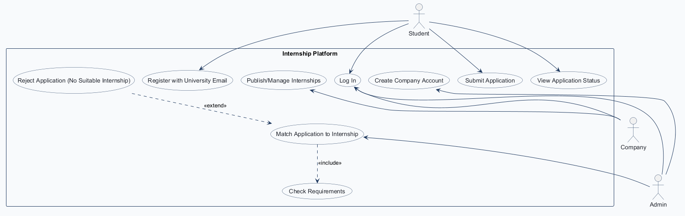
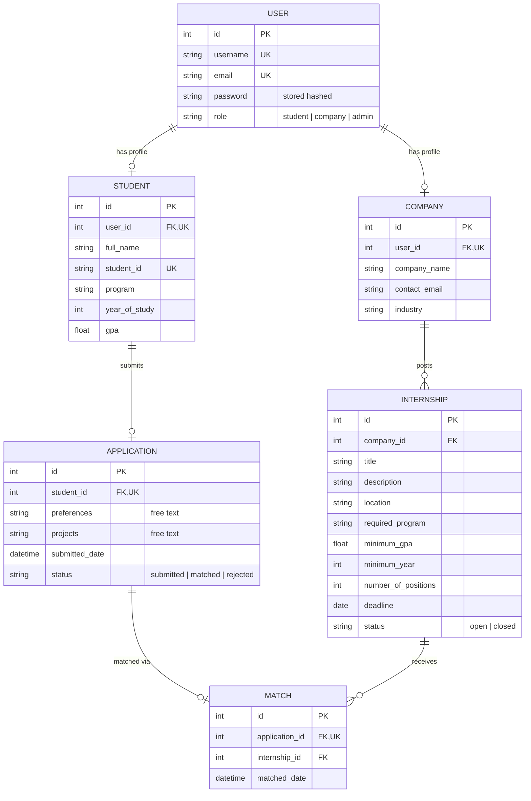
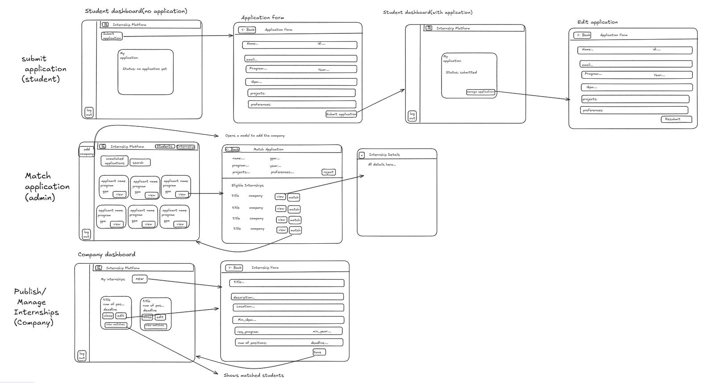

# COMP 3613 Assignment 1

Draft this file with the Guide. **Update it after every phase milestone** before you pause. The use-case diagram is a UML PNG at `docs/diagrams/use-case.png`, linked from this file as `diagrams/use-case.png` (path relative to `docs/report.md`). The model diagram is Mermaid. **Embed wireframe images** as `wireframes/<file>` (files live in `docs/wireframes/`).

Do not put your student ID in this file if you will commit it. The PDF cover adds your name and ID at export time.

## Assigned project

**Internship Platform** — a departmental system that takes student applications and distributes / matches them across internship positions offered by participating companies.

## Three workflows

Three workflows named by the student (three is the minimum), as `Feature (user)`. Screen steps are shown in the Phase 4 wireframes.

### 1. Publish/Manage Internships (Company)

### 2. Submit Application (Student)

### 3. Match Application to Internship (Admin)

Review Application (Company) was removed after Phase 2/3 because the Admin's match is final.

## Use case diagram

Source: `docs/diagrams/use-case.json` (rendered with `python manage.py usecase`).

Phase 2 decisions:

- **Include:** Match Application to Internship «include» Check Requirements. The system always checks the student's GPA, program and year against the internship's requirements before a match.
- **Extend:** Reject Application (No Suitable Internship) «extend» Match Application to Internship. This happens only when no available internship fits the student.
- **General pool:** students do not apply to a specific internship, so there is no Browse Internships use case. Before a match, only the Admin sees an application. The Admin's match is final: companies do not review or reject matched students.
- **Matched students (Company):** a company sees the students matched to its internships as part of Publish/Manage Internships, not as a separate use case.
- **Gap filled, View Application Status (Student):** this is how a student learns whether they were matched or rejected.
- **Accounts:** students register with a university email address. Companies cannot register themselves; the Admin creates each company account once the company is approved (Create Company Account). Log In is shared by Student, Company and Admin.

## Model diagram

First draft. Update this section in Phase 5 when polish revises the model, and note what changed.

Phase 3 decisions (entities and properties named by the student):

- **User → Student / Company:** each Student or Company profile belongs to exactly one User (`user_id` is unique). Admins are Users with `role = admin` and have no profile.
- **Application → Match (one-to-one, FK on Match):** the Admin's match is final, so an application has at most one Match (`application_id` is unique).
- **Internship → Match (one-to-many, FK on Match):** an internship can receive several matches, up to its number of positions.
- **Projects** (added by the student after the first draft) is a free-text property on Application, where the student lists relevant projects.
- **Preferences** are free text. Students do not pick or rank internships (general pool), so Application connects to Internship only through Match.
- **Final match:** the Admin's match is final, so an application has at most one Match and Match has no status.
- **Positions filled:** when the number of Matches reaches `number_of_positions`, the internship switches to `closed` automatically. The Admin can match applications only to `open` internships.
- **Delete vs close:** a company cannot delete an internship that has any Match rows, because those rows are students' final placements. It closes the internship instead. A closed internship gets no new matches, and existing matches are kept. An internship with no Match rows can be deleted normally. *(Superseded in Phase 4: delete is dropped; companies only close.)*

Assumptions (not asked; revisit in Phase 4/5):

- Every Match counts toward `number_of_positions`, since matches are final.
- ~~Student → Application is one-to-many~~. Replaced in Phase 4: one application per student.
- `Application.status`: `submitted` until the Admin acts, `matched` once the Admin matches it (final), `rejected` when the Admin finds no suitable internship.

Revision (Review Application removed): dropped `MATCH.status` and the `accepted` value on `APPLICATION.status`; removed company accept/reject and re-matching. Application → Match changed from one-to-many to one-to-one (`MATCH.application_id` unique).

Revision (Phase 4, from the wireframes; accepted by the student):

- **Removed `APPLICATION.cover_statement`**: it is not on the Application form or the Edit application screen.
- **Student → Application is one-to-one** (`APPLICATION.student_id` unique): the student dashboard shows a single "My application" card.
- **Delete internship dropped**: the company card shows only close / edit / view matches, so companies close internships and never delete them.

## Wireframes

One student-drawn sheet covers all three workflows (rows: Submit Application, Match Application, Publish/Manage Internships).

### Submit Application (Student) · Match Application to Internship (Admin) · Publish/Manage Internships (Company)

### Phase 4 workflow decisions

- **Submit Application (Student):** the dashboard shows one "My application" card. The Application form creates the student's `STUDENT` profile on first submit (name, ID, program, year, GPA), and Edit / Resubmit update that same profile. `APPLICATION` keeps preferences, projects, date and status. The email field is filled in from `USER.email` and is read-only (assumed).
- **Resubmit after rejection:** when the status is `rejected`, "manage application" appears again. The student edits and resubmits, the status goes back to `submitted`, and the application returns to the Admin's unmatched list. While the status is `submitted`, the student can still edit (assumed). Once it is `matched`, the application is locked.
- **View Application Status (Student):** when the status is `matched`, the card shows the internship title, company name and location (via `MATCH → INTERNSHIP → COMPANY`).
- **Match Application to Internship (Admin):** the Students / Internship header buttons switch the admin dashboard between application cards (unmatched filter + search) and an internship list. Match Application lists only eligible internships (Check Requirements); **match** returns the Admin to the dashboard.
- **Reject Application (Admin):** the **reject** button on Match Application sets the status to `rejected` and returns the Admin to the dashboard (assumed).
- **Create Company Account (Admin):** the "add company" button in the admin sidebar opens a modal. Its fields are not drawn, so it uses the ERD fields: `USER` username / email / password (role `company`) plus `COMPANY` company_name / contact_email / industry.
- **Publish/Manage Internships (Company):** new / edit open the Internship Form and Save returns to the dashboard. Close sets the status to `closed`. View matches shows the matched students.
- **Log In / Register with University Email:** these reuse the starter login and register screens, themed in Phase 5. They have no wireframe.

<!-- student-build:wireframe-coverage
use_case: Submit Application
image: docs/wireframes/wireframes.png
covered: yes
-->
<!-- student-build:wireframe-coverage
use_case: View Application Status
image: docs/wireframes/wireframes.png
covered: yes
-->
<!-- student-build:wireframe-coverage
use_case: Match Application to Internship
image: docs/wireframes/wireframes.png
covered: yes
-->
<!-- student-build:wireframe-coverage
use_case: Check Requirements
image: docs/wireframes/wireframes.png
covered: yes
-->
<!-- student-build:wireframe-coverage
use_case: Reject Application (No Suitable Internship)
image: docs/wireframes/wireframes.png
covered: yes
-->
<!-- student-build:wireframe-coverage
use_case: Create Company Account
image: docs/wireframes/wireframes.png
covered: yes
-->
<!-- student-build:wireframe-coverage
use_case: Publish/Manage Internships
image: docs/wireframes/wireframes.png
covered: yes
-->
<!-- student-build:wireframe-coverage
use_case: Log In
image: none (starter login screen)
covered: yes
-->
<!-- student-build:wireframe-coverage
use_case: Register with University Email
image: none (starter register screen)
covered: yes
-->

## Theming

Branding preferences and how they were applied (landing / login / register).

Preferences (from the student):

- **Colors:** navy (`#1b2a4a`) for headings, the sidebar and the wordmark. An emerald accent (`#047857`, hover `#065f46`, soft tint `#ecfdf5`) for primary buttons (white text), links, focus rings and the active sidebar link. White (`#ffffff`) surfaces on a light grey background (`#f3f5f8`).
- **Type:** Inter (Google Fonts), a clean sans-serif used everywhere, including headings.
- **Tone:** friendly and academic. Example copy: "Find the internship that fits you", "Welcome back! Sign in to your dashboard."
- **Wordmark:** **InternSearch**, a text wordmark with "Intern" in navy and "Search" in emerald (light emerald `#6ee7b7` on the navy sidebar).

How the theme was applied:

- **Tokens:** `app/static/css/app.css` holds the `--brand-*` tokens. It also overrides the Bootstrap primary color, `.btn-primary`, focus rings and cards, so stock components use the brand without extra classes.
- **Landing (`/`):** white page with a navy and emerald hero and a "How InternSearch works" panel (students apply → companies post internships → the department matches). The footer notes that company accounts are created by the department.
- **Login / Register:** white card with an emerald top border on a light grey background, and the wordmark. Register labels the email field "University email" and adds a hint. The domain check itself is not built yet; it comes with the Register with University Email use case.
- **Authenticated shell:** navy sidebar with the wordmark, emerald active link, and a "Dashboard" link that goes to `/admin` for admins and `/app` for everyone else. The 401 page uses the navy → emerald gradient.
- **Polish (student requests):** the accent went from teal to gold, then from gold to **emerald**. The deeper emerald (`#047857`) keeps white button text and small text on white readable.
- **Removed starter demo UI:** the public `/api/users` JSON endpoint (`app/routers/users.py`) and the landing page's demo-login footer. Placeholder copy on the dashboards was reworded. `/config` and the starter auth are kept.

## Implementation notes

One named workflow at a time. Include verify notes and polish / model revisions (Phase 5). Do not treat the first build as final.

### 1. Submit Application (Student): verified

- **Route shape (student's choice):** one form route, `GET/POST /app/application`, used for both the first submit and Edit / Resubmit. The template switches between "Application form" with **Submit application** and "Edit application" with **Resubmit**.
- **Layers:**
  - `Student` and `Application` SQLModels: `app/models/student.py`, `app/models/application.py`.
  - `StudentRepository` and `ApplicationRepository`.
  - `ApplicationForm` schema.
  - `ApplicationService`: `get_for_user`, `submit_application`.
  - Thin route: `app/routers/application.py`.
  - Dashboard card in `app.html`, form in `application_form.html`.
- **Rules (service):**
  - The first submit creates the STUDENT profile, and later submits update it.
  - Each submit sets `status = submitted` and refreshes `submitted_date`.
  - A `matched` application is refused (the student picked the Service layer for this rule).
  - A student ID already used by another account is refused.
- **Roles:** registration now creates users with `role = student`, matching the ERD's `USER.role`. Only students can open the form routes. The seeded `bob` is a student.
- **Deferred:** the matched card's internship title, company and location will be added with the Match workflow, which introduces INTERNSHIP and MATCH.
- **Verify (student):** ran `init` + `run` as bob. The submit → dashboard (Submitted) → manage → resubmit flow works. No mismatches reported yet; revisit in the final polish pass.
- **Student snippets:**
  - SQLModel `Student`: `user_id` FK + unique, `student_id` unique, plus the profile fields.
  - Thin POST route: calls `ApplicationService` and handles `ApplicationError` with a flash message and redirect.

<!-- student-build:code-check
workflow: Submit Application (Student)
form: choice
layer: router
architecture_ok: yes
implement_confidence: 0.75
passed: yes
note: Picked one GET/POST /app/application route for submit + resubmit.
-->
<!-- student-build:code-check
workflow: Submit Application (Student)
form: mcq
layer: service
architecture_ok: yes
implement_confidence: 0.80
passed: yes
note: Placed the "matched application is locked" rejection in the service.
-->
<!-- student-build:code-check
workflow: Submit Application (Student)
form: snippet
layer: model
architecture_ok: yes
implement_confidence: 0.85
passed: yes
note: Student fields match ERD incl. user_id FK+unique and student_id unique.
-->
<!-- student-build:code-check
workflow: Submit Application (Student)
form: snippet
layer: router
architecture_ok: yes
implement_confidence: 0.90
passed: yes
note: Thin route builds ApplicationForm, calls ApplicationService, flashes ApplicationError and redirects; no SQL.
-->

### 2a. Create Company Account (Admin): verified

Built before Publish/Manage Internships. The student chose to start with the admin side, so test company accounts come from the real modal rather than seed data.

- **UI:** an **Add company** button at the top of the admin sidebar (as on the wireframe) opens a modal. It has the COMPANY fields from the ERD (company name, contact email, industry) and the USER login fields (username, login email, password).
- **Layers:**
  - `Company` SQLModel: `app/models/company.py`.
  - `CompanyRepository`.
  - `CompanyAccountForm` schema.
  - `CompanyService.create_company_account`.
  - Thin route `POST /admin/companies` in `app/routers/admin_home.py`, admin-only.
- **Rules (service):**
  - A username or login email that is already taken is refused.
  - The new USER gets `role = company`.
  - If saving the COMPANY profile fails, the new login is removed, so there is never a company login without a profile.
- **Verify (student):** created a company from the admin modal and signed in as it. It lands on the empty company dashboard, which Publish/Manage Internships fills next.
- **Student snippet:** SQLModel `Company`: `user_id` FK + unique, `company_name`, `contact_email`, `industry`.

<!-- student-build:code-check
workflow: Create Company Account (Admin)
form: choice
layer: other
architecture_ok: yes
implement_confidence: 0.85
passed: yes
note: Chose to build the admin add-company modal before Publish/Manage instead of seeding a demo company.
-->
<!-- student-build:code-check
workflow: Create Company Account (Admin)
form: snippet
layer: model
architecture_ok: yes
implement_confidence: 0.90
passed: yes
note: Company fields match ERD incl. user_id FK+unique (one profile per user).
-->

### 2. Publish/Manage Internships (Company): verified

- **Business rule (student's choice):** a closed internship is final. Its card keeps only **View matches**. Edit and close are hidden in the UI and also refused by the service.
- **Screens:**
  - Company dashboard (`company_home.html`): **My internships** with **New**. Each card shows the title, `matched / positions filled`, the deadline and an Open/Closed badge, with Close (confirmed), Edit and View matches buttons.
  - Internship Form (`internship_form.html`): used for both new and edit; Save returns to the dashboard.
  - View matches (`internship_matches.html`): each matched student's name, ID, program, year, GPA, email and match date.
- **Layers:**
  - `Internship` and `Match` SQLModels. MATCH was added here because View matches reads it; the Match workflow writes it.
  - `InternshipRepository` and `MatchRepository` (match counts and the matched-student join).
  - `InternshipForm` schema.
  - `InternshipService`.
  - Thin routes in `app/routers/internships.py`, company-only via `CompanyDep`.
- **Rules (service):**
  - Only the owning company can see or change an internship.
  - Edit and close are refused on a closed internship.
  - A new internship's deadline can't be in the past.
  - `number_of_positions` can't drop below the number already matched.
  - Reaching `number_of_positions` matches closes the internship (Phase 3 rule).
- **Verify (student):** re-created a company, then tested new → save, edit, close and view matches. Reported working with no mismatches; revisit in the final polish pass.
- **Student snippets:**
  - SQLModel `Internship`: `company_id` FK, the ERD fields, `status` defaulting to `open`.
  - Thin create route. The first attempt was missing the success redirect (it returned `None`); the student fixed it after review.

<!-- student-build:code-check
workflow: Publish/Manage Internships (Company)
form: choice
layer: service
architecture_ok: yes
implement_confidence: 0.85
passed: yes
note: Closed internships are final — only view matches; edit/close refused.
-->
<!-- student-build:code-check
workflow: Publish/Manage Internships (Company)
form: snippet
layer: model
architecture_ok: yes
implement_confidence: 0.88
passed: yes
note: Internship fields match ERD; company_id FK; status defaults to "open".
-->
<!-- student-build:code-check
workflow: Publish/Manage Internships (Company)
form: snippet
layer: router
architecture_ok: yes
implement_confidence: 0.80
passed: partial
note: First attempt missed the success redirect (returned None); flagged in review.
-->
<!-- student-build:code-check
workflow: Publish/Manage Internships (Company)
form: snippet
layer: router
architecture_ok: yes
implement_confidence: 0.85
passed: yes
note: Second pass adds flash + redirect to dashboard; route stays thin, no SQL.
-->

### 3. Match Application to Internship (Admin): verified

- **Business rule (student's choice):** Check Requirements excludes internships whose deadline has passed.
- **Screens:**
  - Admin dashboard (`admin.html`): **Students / Internships** header buttons. Students has an **Unmatched applications / All** filter, search (name, student ID or program) and application cards with **View**. Internships lists every internship with its company, requirements, filled/positions, deadline and status.
  - Match Application (`admin_application.html`): the student's details, projects and preferences, and **Reject**. **Eligible internships** each have **View** (Internship Details modal) and **Match** (confirmed, because matches are final). Match and Reject both return to the dashboard.
  - Student dashboard: a matched card now shows the internship title, company, location and match date (View Application Status; this was deferred from workflow 1).
- **Layers:**
  - `Match` SQLModel.
  - `ApplicationRepository.search_with_students`.
  - `InternshipRepository.find_matching` (the Check Requirements query) and `get_all_with_company`.
  - `MatchRepository.create_match` (one commit) and `get_placement`.
  - `MatchService`.
  - Thin routes in `app/routers/admin_home.py`.
- **Rules (service):**
  - Eligible means: `status = open`, deadline ≥ today, the program matches (ignoring case and spaces), GPA ≥ `minimum_gpa`, and year ≥ `minimum_year`.
  - Only `submitted` applications can be matched or rejected.
  - Eligibility and remaining positions are checked again on the server before a match.
  - The match, `application.status = matched`, and the auto-close (when the last position is filled) are saved together in one commit.
- **Verify (student):** ran the full chain (admin creates a company → company publishes → students apply → admin matches and rejects). Reported that all three workflows work.
- **Student snippets:**
  - SQLModel `Match`: `application_id` FK + unique (a final match, one per application), `internship_id` FK, `matched_date` default now.
  - Thin match route: calls `MatchService.match_application` and handles `MatchError`, returning to the Match Application screen.

<!-- student-build:code-check
workflow: Match Application to Internship (Admin)
form: choice
layer: service
architecture_ok: yes
implement_confidence: 0.82
passed: yes
note: Check Requirements excludes internships whose deadline has passed.
-->
<!-- student-build:code-check
workflow: Match Application to Internship (Admin)
form: snippet
layer: model
architecture_ok: yes
implement_confidence: 0.88
passed: yes
note: Match has application_id FK+unique (final match), internship_id FK, matched_date default now.
-->
<!-- student-build:code-check
workflow: Match Application to Internship (Admin)
form: snippet
layer: router
architecture_ok: yes
implement_confidence: 0.90
passed: yes
note: Thin route calls MatchService.match_application; MatchError -> flash + back to Match Application; success -> dashboard.
-->

### Polish pass 1 (all workflows)

After all three workflows worked, the Guide listed loose ends against the design and the student chose to fix all four. The student supplied the two business values (the `.edu` domain rule and the 4.3 GPA cap).

- **Register with University Email (Phase 2 use case, previously unenforced):** student sign-up now only accepts an email whose domain ends in **`.edu`** (for example `name@my.uwi.edu`). The rule is in `AuthService.register_user`, which raises a `RegistrationError` shown on the form, and the form also checks the format in the browser. The service now checks for a duplicate username or email itself, instead of relying on a database error. Company logins (created by the Admin) are not restricted.
- **GPA cap at 4.3:** the Application form's GPA and the Internship form's minimum GPA must be between 0 and 4.3 (`app/utilities/grading.py`, `GPA_MAX`). The services enforce it with a readable message, and the inputs carry `max="4.3"`.
- **Deadline-passed badge:** an internship that is `open` but past its deadline is shown as **Deadline passed** on the company dashboard and the admin Internships list. This makes the student's "past deadline = not eligible" rule visible.
- **Matched-to on admin cards:** in the admin **All** view, a matched application's card shows the internship title and company it was matched to (`MatchRepository.get_placements`).
- **Model:** no ERD change. The GPA range and the `.edu` rule are business rules in the services, not new columns.
- **Verify (student):** checked the polish pass and reported it done. Phase 5 exit gate met: all three workflows work locally, and the student steered the polish (four fixes plus the `.edu` and 4.3 values).

## Deployed app

Phase 6. Public Render URL (not localhost). Markers open this to mark the three workflows.

https://faststarter-07fs.onrender.com

- Hosted on Render's free plan in Oregon: web service `faststarter` and Postgres 16 `faststarter-db`, created with the Render MCP to match `render.yaml`.
- Start command: `python manage.py init --no-drop && python manage.py run --host 0.0.0.0 --port $PORT`. Tables are not dropped on reboot, and the seed users are added only if they are missing.
- The free web service sleeps when idle, so the first request can take about a minute. The free database expires on **2026-11-11**.
- **Verify (student):** the database was reset once with a one-off deploy that dropped the tables. The student then ran all three workflows on the public URL (Submit Application as bob, Publish/Manage Internships as comp1, Match Application as admin) and reported that they work.

## Logins

Every account a marker needs, including extra users you added. Starter accounts:

- bob / bobpass: student (seeded; Submit Application)
- admin / adminpass: admin (Match Application, Add company)
- comp1 / comppass: company (Publish/Manage Internships). Not seeded: created on the live site with the admin's **Add company**.

## YouTube URL

https://youtu.be/RPX4wAlBhw8

## Session transcripts

Filled when the Guide builds the report: the agent writes each Guide chat to `docs/transcripts/<slug>.md` (Copilot Agent, Cursor, or OpenCode). `python manage.py report` packages them. Do not paste chats here during the build.

## Competency (student-judge)

Filled when the report is built. Guide runs student-judge, writes `docs/judge.md`, and export appends the scorecard here.

## Skill integrity

Filled by `python manage.py report`. Do not edit the course skills.
